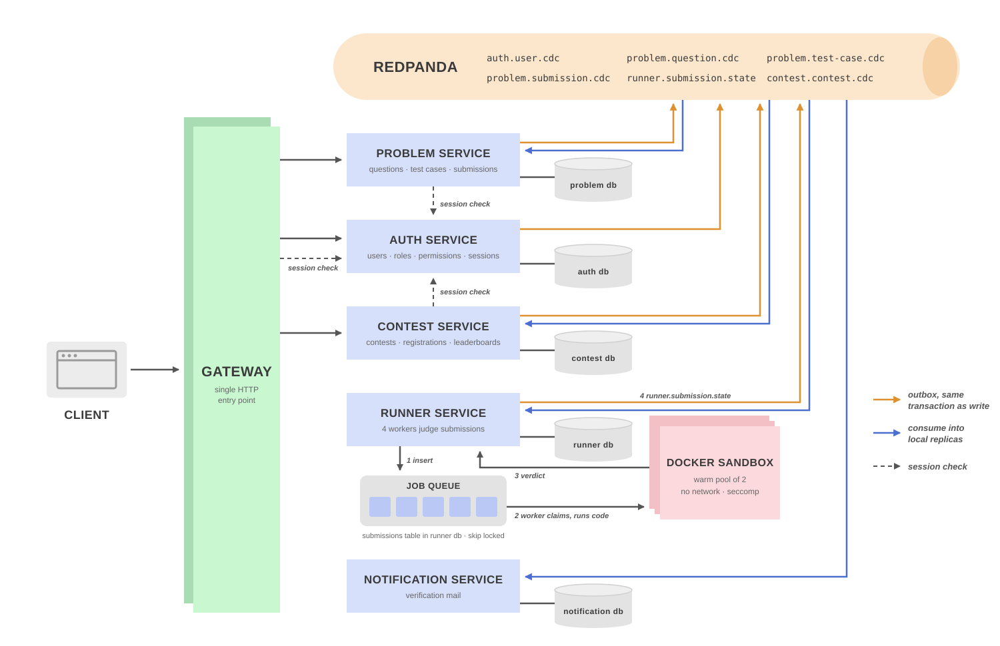

# CodeClash

A competitive programming platform. Users solve coding questions in C++, Java or Python, their code is judged in Docker sandboxes, and timed contests rank them on a leaderboard.

## Overview

CodeClash is a Gradle multi-project: six Spring Boot services in `app/`, five shared libraries in `lib/`, and an Angular frontend in [`app/web`](app/web/README.md).

| Service | Owns |
| --- | --- |
| [Auth](app/auth-service/README.md) | users, roles, permissions and sessions |
| [Problem](app/problem-service/README.md) | questions, test cases and submissions |
| [Runner](app/runner-service/README.md) | judging submissions in sandboxes |
| [Contest](app/contest-service/README.md) | contests and leaderboards |
| [Notification](app/notification-service/README.md) | verification emails |
| [Gateway](app/gateway-service/README.md) | the single HTTP entry point |

- Each service has its own Postgres database and never reads another service's database.
- Services share data by publishing change events through a transactional outbox to Redpanda (Kafka). Consumers keep local copies of what they need.
- Sessions are opaque bearer tokens, checked against the auth service.

## Tech stack

- **Language and build:** Java 25, Gradle 9.8.2 (version catalog, Kotlin DSL), Lombok via the freefair plugin 9.8.3
- **Framework:** Spring Boot 4.1.2, Spring Modulith 2.1.1, Spring Cloud Gateway Server WebMVC (Spring Cloud 2025.1.4), virtual threads
- **Messaging:** Redpanda v26.2.6, Spring for Apache Kafka, Namastack Outbox 1.11.0
- **Data:** PostgreSQL 18.6, Spring `JdbcClient`, Flyway 12.4.0 (run through the Gradle plugin)
- **Sandbox:** Docker, a runner image on `eclipse-temurin:25.0.4_7-jdk-noble` with g++, Python 3 and a seccomp syscall filter
- **Security:** Argon2 password hashing (Spring Security Crypto, Bouncy Castle 1.86)
- **Mail:** Spring Mail with Thymeleaf templates, Mailpit v1.31.6 locally
- **Observability:** OpenTelemetry, datasource-micrometer 2.3.0, Grafana `otel-lgtm` 0.34.0
- **API docs:** springdoc-openapi 3.2.0, Jackson 3, jackson-databind-nullable 0.2.10 for PATCH bodies
- **Frontend:** Angular 22 with server-side rendering on Express 5, zoneless, Tailwind CSS 4, Node 26, npm 12
- **Frontend tooling:** Biome 2.6.7, Prettier 3 with `prettier-plugin-tailwindcss` for templates
- **Ops tool:** Go 1.26 ([`./codeclash`](tools/codeclash/README.md))

## API

All requests go through the gateway, on port 8000 locally. Swagger UI is at `/swagger-ui.html` on the gateway.

Paths look like `/api/v1/...`. An unsupported version gets 400 `INVALID_API_VERSION`.

| Path prefix | Service |
| --- | --- |
| `/api/v1/sessions`, `/users`, `/roles`, `/permissions` | Auth |
| `/api/v1/questions`, `/categories`, `/tags`, `/submissions` | Problem |
| `/api/v1/contests` | Contest |
| `/v3/api-docs/{auth,problem,contest}`, `/swagger-ui.html` | Gateway |

## Running locally

Everything goes through `./codeclash`. See [tools/codeclash/README.md](tools/codeclash/README.md) for details.

- **Compose:** `./codeclash up` starts Postgres, Redpanda, Mailpit, Grafana, pgAdmin and Kafka UI. Run the services from the IDE with the `dev` Spring profile, then seed with `./codeclash pipeline admin questions contests`. Ports come from `.env` (copy `.env.example`).
- **kind:** `./codeclash pipeline` builds every image, deploys to a local kind cluster and seeds it. The app is at `http://localhost:8080`.

## Deploying

The same tool deploys to an existing cluster such as k3s on a server, with a domain and Let's Encrypt TLS. See [Running on a server](tools/codeclash/README.md#running-on-a-server-k3s).

Each service has its own `Dockerfile`. The Spring images are built from the repository root, run as UID 10001, and take all their configuration from environment variables (`k8s/services` ConfigMaps).
