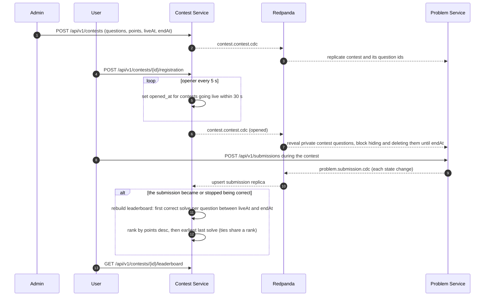

# Contest Service

Runs timed contests over questions from the problem service. Users register for a contest and are ranked on a leaderboard.

## Overview

- A **contest** has a name, a description, a live time, an end time and a set of questions, each worth some points.
- A scheduled **opener** marks a contest as opened shortly before it goes live and publishes that on `contest.contest.cdc`. From then on its questions are visible to everyone, and its schedule and questions are locked.
- It keeps copies of users, questions and submissions from Kafka.
- The **leaderboard** is rebuilt whenever a submission's correctness changes. Only the first correct solve per question inside the contest window counts. Users are ranked by points, then by the earliest last solve.
- Data lives in the `contest` database.

## Contest lifecycle

## API

Request and response shapes are in Swagger UI on the gateway.

| Method | Path | What it does | Permission |
| --- | --- | --- | --- |
| GET | `/api/v1/contests` | List contests | — |
| GET | `/api/v1/contests/{ID}` | Get a contest; questions stay hidden until it starts | — (`contest:contest:read_questions` sees them early) |
| GET | `/api/v1/contests/{ID}/leaderboard` | Paged standings with username, points, solved and rank | — |
| POST | `/api/v1/contests/{ID}/registration` | Register the caller, until the contest ends | signed in |
| DELETE | `/api/v1/contests/{ID}/registration` | Unregister the caller, before the contest starts | signed in |
| POST | `/api/v1/contests` | Create a contest with questions and points | `contest:contest:write` |
| PUT | `/api/v1/contests/{ID}` | Replace a contest, or create it under that id | `contest:contest:write` |
| PATCH | `/api/v1/contests/{ID}` | Update some fields; live time and questions are locked once started | `contest:contest:write` |
| DELETE | `/api/v1/contests/{ID}` | Delete a contest that has not started | `contest:contest:write` |
