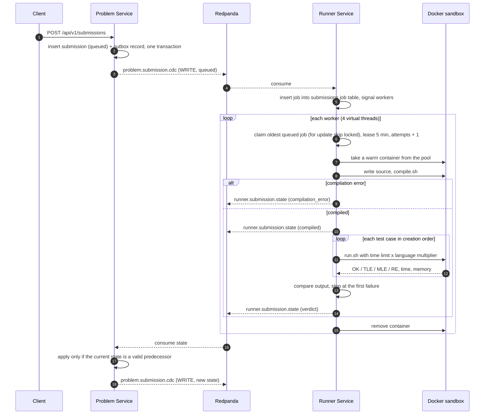

# Runner Service

Judges submitted code. It takes queued submissions from Kafka, compiles and runs them in Docker sandboxes against every test case, and publishes the verdict.

## Overview

- No HTTP API. It keeps copies of question limits and test cases from `problem.question.cdc` and `problem.test-case.cdc`.
- Queued submissions from `problem.submission.cdc` become rows in a job table.
- Up to `max-concurrent` workers (4 by default) claim jobs (`for update skip locked`, five-minute lease). A job is retried up to three times when a sandbox fails.
- Each job runs in a fresh container from a warm pool: no network, read-only filesystem, dropped capabilities, memory and CPU limits, and a seccomp filter. Containers are never reused.
- The time limit is multiplied per language (C++ 1×, Java 2×, Python 3×). Output is compared line by line, ignoring trailing whitespace.
- States are published on `runner.submission.state`. Data lives in the `runner` database.
- Needs the `docker` CLI and the `codeclash-runner:local` image (`docker compose --profile build build runner-image`).

## Judging

